# Voxel ray-tracing structures compared: Caelix, 64-trees, ESVO, brick maps, distance fields, NanoVDB and NAADF

Benchmark report, 2026-10-19. Machine: Intel Core i7-14700KF, 64 GB RAM, NVIDIA GeForce RTX 5080 (16 GB, driver 610.88), Windows 11 Pro for Workstations. All numbers in this report were measured on this machine during 2026-10-18/19 with the scripts in `scripts/`; the raw per-run JSON files are in `results/`.

Audience: readers who know the main idea of each structure but not its details. Sections 2 and 3 give the details that matter for reading the numbers. Section 4 is the measurement protocol. Sections 5 to 8 are the results. Section 9 lists everything that limits the comparison.

## Summary for the impatient

- **Primary rays (2560 x 1440, 8K Bistro, median GPU time): NAADF 0.52 ms, Tree64 0.89 ms, Caelix 0.93 ms, StdBVH 1.63 ms, NanoVDB 2.08 ms, ESVO 2.13 ms.** Caelix's hardware ray query ties the best software 64-tree and is 1.8x slower than NAADF's distance-field traversal.
- **Primary + 2 diffuse bounces, by rays actually traced: NAADF 2,124 Mrays/s, Tree64 1,930, Caelix 1,441, ESVO 822, StdBVH 712, NanoVDB 605.** Caelix frame time (6.2 ms) looks closer to Tree64 (5.5 ms) only because its Russian roulette casts 15 % fewer rays.
- **Memory for the 8K Bistro (301 M voxels): ESVO 0.37 GiB, StdBVH 0.38, Tree64 0.49, NanoVDB 0.99, NAADF 2.35 (4.5 allocated), Caelix 5.23 GiB.** Caelix's lossless 1,096-byte brick records store the air inside bricks; the acceleration structure itself is 8 % of its total.
- **Dynamic scene (18,432 bricks changed per frame): Caelix 7 ms per frame all on the GPU, XBrickMap 17 ms, NAADF 43 ms (CPU hashing), NanoVDB in-place 24 ms, full rebuilds 62 to 492 ms for NanoVDB, StdBVH, ESVO and Tree64 as implemented.** No method hit the 2 s "cannot run" limit, but only five are interactive at this edit rate.
- **NanoVDB is usable but not competitive for opaque surface voxels**: 2.3x slower than Tree64 on primary rays, 3.2x on bounce rays, 2x the memory; its HDDA steps single voxels inside every existing leaf.
- Five VoxelRT methods (PlainDDA, MultiDDA, the three distance fields; XBrickMap and ESVO before a constant change) cannot hold the 8K scenes because of fixed 4096-voxel windows; they were measured on a 4096 Bistro.

## 1. What was compared and why

Voxel renderers need a structure that answers one question fast: "along this ray, where is the first solid voxel?" For a path tracer the same question is asked again for every bounce, with rays that no longer share a direction with their neighbours. The structures below answer it in different ways:

| Method | Family | Where the work happens | Reference implementation used |
| --- | --- | --- | --- |
| **Caelix** | Hardware ray tracing: one AABB per 8^3 brick in a BLAS per 16^3-brick group, one TLAS, DDA inside the brick | RT cores for the box hierarchy, compute shader (Vulkan ray query) for the brick | `Caelix-Renderer`, the project's own native renderer (C++/Vulkan, HLSL) |
| **Tree64** (sparse 64-tree) | Space partition: 4^3-branching sparse tree, 12-byte nodes with a 64-bit child mask | Compute shader | VoxelRT (dubiousconst282), Slang/Vulkan |
| **ESVO** (sparse voxel octree) | Space partition: 2^3 octree with 4-byte child descriptors, no contours, no beam optimization | Compute shader | VoxelRT port of Laine and Karras 2010 |
| **StdBVH** | Object partition: binary BVH over 8^3 bricks (software), DDA inside the brick | Compute shader | VoxelRT (madmann91/bvh builder) |
| **XBrickMap** | 3-level grid: 32^3 sectors of 4^3 bricks of 8^3 voxels, 4^3 occupancy masks | Compute shader | VoxelRT |
| **MultiDDA / PlainDDA** | Two-level and flat uniform grids with DDA | Compute shader | VoxelRT |
| **ManhattanDF / EuclideanDF / OctantDF** | Space skipping by stored distance fields at 1:4 resolution (isotropic, or 8 directional) | Compute shader | VoxelRT |
| **NanoVDB** | VDB tree (root, 32^3, 16^3, 8^3 leaf) traversed with the hierarchical DDA (HDDA) | Compute shader | Official NanoVDB headers (OpenVDB v13.1.0, PNanoVDB.h) built into the VoxelRT harness for this report |
| **NAADF** | 3-level cells (16^3 chunk, 4^3 block, voxel) with axis-aligned distance fields in empty cells | Compute shader (D3D11) | cg-tuwien/NAADF, the authors' code (C#, MonoGame) |

The owner's questions were: how does Caelix's hardware-ray-tracing design compare with the best software structures on the same scenes and GPU, in ray throughput, memory and update cost; and whether NanoVDB, which NVIDIA staff recommended for RTX voxel engines, is a useful option.

The comparison is deliberately narrow: **primary visibility rays** and **primary rays plus two diffuse bounces**, with no denoiser, no next-event estimation, no shadow rays, no temporal reuse. That is the part of a frame where the data structure decides the cost; everything else (denoising, resampling, materials) is a renderer design choice that would hide the structure's behaviour.

## 2. The methods in enough detail to read the numbers

### 2.1 Caelix (hardware ray query over brick AABBs)

- **Data.** The scene is a set of 8^3 bricks. Each brick is a 1096-byte GPU record: an 8-byte header, a 64-byte occupancy mask and 512 raw 16-bit block values (lossless; the material and colour live in the value). Bricks are grouped in 16^3-brick render groups; each group has a dense id table (16 B per brick slot) and one BLAS whose primitives are **one AABB per non-empty brick**, tightly fitted to the occupied voxels. One TLAS references all groups.
- **Traversal.** A compute shader issues a Vulkan ray query. The RT cores walk the TLAS and BLAS; every AABB candidate returns to the shader, which loads the brick record and runs a DDA over the 8^3 cells (at most 22 steps, with coarse and micro occupancy skipping) and commits the nearest hit. The shader then continues the path.
- **Memory.** Records 1096 B per brick, plus 16 B per id slot, plus the BLAS/TLAS (measured below), plus a 12-target G-buffer that is not counted.
- **Updates.** Bricks are uploaded through a staging ring; a finalize kernel rewrites the records of changed bricks and their 6 neighbours; the BLAS of every touched group is rebuilt and the TLAS refreshed, once per frame.
- **Published context.** Lacewell (Ray Tracing Gems II, 2021), Soderlund et al. (JCGT 2022) and Derin et al. (SIGGRAPH Asia 2021) all study AABB-per-brick with an in-shader DDA on RTX/RDNA hardware. They agree that bricks cost about 7 to 20 times less acceleration-structure memory than one AABB per voxel, at about 1.8 times the ray cost, and that re-entering the acceleration structure after every brick is the main overhead. No peer-reviewed comparison of this design against 64-trees or NAADF existed before this report.

### 2.2 Tree64 (sparse 64-tree) and ESVO

- **Tree64.** A node is 12 bytes: a 64-bit mask of occupied 4^3 children, a 31-bit pointer to the left-packed child array and a leaf bit. A 4096^3 world is 6 levels deep (an octree needs 12). The traversal (dubiousconst282 2024) descends to the first empty cell or voxel, treats the empty cell as a box, jumps to its exit plane, clamps into the neighbour, and finds the common ancestor with one bit trick on the float mantissa. Materials are stored as one byte per leaf voxel. VoxelRT rebuilds the whole tree on the CPU for any edit.
- **ESVO.** Laine and Karras 2010. The VoxelRT port keeps the 32-bit topology half of the child descriptor (8-bit valid mask, 8-bit leaf mask, 15-bit child pointer, far bit), without contours and without the beam optimization. 23-level stack traversal. No materials. Rebuilt on the CPU for any edit.

### 2.3 Brick maps, grids and distance fields (VoxelRT)

- **XBrickMap.** 32^3 sectors hold up to 64 bricks of 8^3 voxels (one byte per voxel, so materials are supported) plus 4^3 occupancy masks. Traversal skips empty sectors, empty bricks and empty 4^3 cells. Edits re-upload whole sectors (GPU side; no CPU rebuild).
- **MultiDDA / PlainDDA.** A dense 4096 x 1024 x 4096 bit grid (2 GiB) plus a brick-level bit grid (MultiDDA). No materials.
- **ManhattanDF / EuclideanDF / OctantDF.** A 3D image of distances at 1:4 resolution (1 or 2 bytes per 4^3 cell, or 8 directional bytes for OctantDF) over the same dense bit grid. The ray marches by the stored distance, then steps voxels inside the last 4^3 cell.

The dense grids fix the world to 4096 x 1024 x 4096 voxels (XBrickMap: 4096 x 2048 x 4096, 2 GiB of bricks). This decides which scenes they can run (Section 4.2).

### 2.4 NanoVDB (HDDA over an official grid)

- **Data.** NanoVDB (Museth 2021) is a read-only, pointer-free snapshot of a VDB tree: a root table, 32^3 upper nodes (270,400 B each), 16^3 lower nodes (33,856 B each) and 8^3 leaves. For this report the grid is built on the CPU from the same 8^3 bricks with the official `tools::build` API (v13.1.0, Apache-2.0) in two variants: `ValueOnIndex` leaves (96 B per leaf plus one byte per active voxel in a blind-data channel; the default) and `UInt8` leaves (608 B per leaf; needed for in-place edits).
- **Traversal.** PNanoVDB.h, NVIDIA's portable C/HLSL/GLSL header, compiled by Slang into the same Vulkan harness as Tree64 and ESVO, with the same ray generation, counters and timer. The hierarchical DDA steps 4096, 128 or 8 voxels across empty nodes, but **one voxel at a time inside any leaf that exists**, even a nearly empty one. The traversal returns the first active voxel (not a level-set zero crossing).
- **Updates.** The topology is fixed. Values and active bits of existing leaves can be changed in place; a new or removed leaf needs a rebuild. GPU-side builders exist only in CUDA. Two variants were measured on the dynamic scene: a full CPU rebuild per frame, and `NanoVDB-inplace`, a grid with a leaf pre-allocated for every brick position of the dynamic domain so that an edit is a 608-byte leaf copy. The second variant is not an official feature.

### 2.5 NAADF

- **Data.** Three fixed layers (Ulschmid et al., Eurographics 2026): a dense grid of 16^3-voxel chunks (4 B, 8 B with entities), pools of 4^3 blocks (4 B) and of voxels (2 B, deduplicated by hashing identical blocks). An empty cell at any layer stores an **axis-aligned distance field**: how far the empty box extends in each of the six axis directions (2 bits per direction for voxels and blocks, 5 bits for chunks).
- **Traversal.** A DDA that jumps across the whole empty box of the current cell, descends one layer at a mixed cell, and stops at a full cell. Three layers, no stack. The authors measured 7029 / 2105 Mrays/s (primary / secondary) at 2160p on an RTX 3090 Ti, 6.5x an SVDAG for primary rays.
- **Updates.** A CPU copy is edited per 16^3 chunk and uploaded; the distance fields are caches that are recomputed in the background over several frames and reset to "no skip" in the meantime, so correctness never depends on them.
- The authors' GI pipeline (plane G-buffer, 32-frame TAA, resampling) is not part of this benchmark; only its primary and bounce traversal is.

## 3. Benchmark design

### 3.1 Modes

| Mode | Rays per pixel | Lighting | What it isolates |
| --- | --- | --- | --- |
| **P** | 1 primary | albedo (or Lambert) only | coherent traversal and the hit test |
| **B2** | 1 primary + up to 2 diffuse bounces (a bounce ray is cast only if the previous ray hit) | sky radiance on miss, albedo throughput, no sun, no shadow rays, no denoiser, no TAA, 1 sample per pixel | incoherent traversal: the structure's behaviour on bounce rays |

Resolution 2560 x 1440, vertical field of view 60 degrees, pixel-centre rays (no jitter), warm-up 30 frames, 200 measured frames, GPU timestamps around the traced passes only (no present, blit, UI or reprojection). Ray counts are **counted on the GPU** in every harness (Caelix: wave-aggregated atomics behind a flag; VoxelRT: its perf counters compiled into a second pipeline; NAADF: a counter UAV in a separate shader variant), in a separate 10-frame pass after the timed frames, so the atomics never touch the timed frames.

Differences that remain between harnesses and are not removed: Caelix applies Russian roulette before the second bounce (probability = max albedo of the first-bounce hit) and samples cosine-weighted; VoxelRT has no Russian roulette and samples cosine-weighted; NAADF has no Russian roulette and samples the hemisphere uniformly. The measured ray counts show the effect (Section 5), and Mrays/s normalizes it out.

### 3.2 Scenes and poses

| Scene | Source | Extent (voxels) | Non-empty voxels | 8^3 bricks | Notes |
| --- | --- | --- | --- | --- | --- |
| bistro-8192 | `VoxelTestScenes/bistro-combined.8192.packed.cxw` | 7719 x 2270 x 8192 | 301.3 M | 4,202,624 | Amazon Lumberyard Bistro, exterior + interior, 3 poses (p3 is inside the restaurant) |
| bistro-4096 | `VoxelTestScenes/bistro-combined.4096.packed.cxw` | 3860 x 1135 x 4096 | 73.3 M | 982,063 | the same scene at half resolution, for the methods with a 4096 window; poses are the 8K poses with positions halved (p3 nudged 8 voxels forward out of a wall) |
| rootfall | `VoxelTestScenes/aigc/rootfall.packed.cxw` | 4385 x 2515 x 5385 | 1,393.6 M | 6,795,940 | a dense generated landscape (40 % of the bricks' voxels are solid), 4 poses |
| fractalcave | generated by `scripts/fractalcave.py` | 384 x 1024 x 384 | 74.7 M | 225,091 | the Titania FractalCave test world (3 x 8 x 3 regions of 128^3, simplex-noise fill), dynamic |

All harnesses load the same voxel coordinates (one voxel = one unit, Y up); rootfall is translated to a non-negative origin for VoxelRT and NAADF and the camera is translated by the same offset. The camera pose is given in the Caelix convention; VoxelRT and NAADF use right-handed cameras, so their images are horizontal mirrors of Caelix's and were flipped for the side-by-side checks (the traced ray set is identical). Every pose was checked visually against the Caelix reference views in `results/reference-views/`.

Materials differ between harnesses because the formats differ: VoxelRT has a 256-entry palette (the 8K Bistro's colours were quantized to 240 entries, average error 1.9/255; emission is white; glass becomes opaque), NAADF turns glass into mirrors, Caelix keeps the original 16-bit values. These differences change the images, not the ray counts or the traversal cost (the bounce ray count agrees within 1 % across all VoxelRT methods and within a few percent across harnesses).

### 3.3 The dynamic scene

FractalCave is Titania's stress test for dynamic voxels: every frame, in each of the 72 regions, a slab of 128 x 4 x 128 voxels (rows `(frame % 32) * 4 .. +4` of the region) is toggled (empty becomes solid, solid becomes empty). That is 4,718,592 voxel toggles and exactly 18,432 changed 8^3 bricks per frame, the same work Unity's `TestWorld.CorruptionTick` creates. Each harness applies the toggle on its own CPU copy and then does whatever its structure needs: Caelix re-uploads the 18,432 brick records and rebuilds the 72 touched BLAS; XBrickMap re-uploads the touched sectors; NAADF re-hashes the touched 16^3 chunks and re-queues their distance fields; Tree64, ESVO, StdBVH, OctantDF and NanoVDB rebuild their whole structure on the CPU. Reported per frame: CPU edit time, CPU update time, GPU update time and GPU render time (mode B2). A method whose update takes more than 2 s per frame is stopped after 5 measured frames and reported as "not interactive".

### 3.4 Metrics

- **GPU time per frame** (ms): median, 5th and 95th percentile over 200 frames. This is the primary comparison; it is independent of how rays are counted.
- **Mrays/s** = counted rays per frame / median GPU time. Comparable across harnesses because every harness counts the rays it actually cast.
- **Iterations per ray** (VoxelRT methods and NAADF): traversal loop iterations, from the counters. Caelix has no equivalent counter (the RT cores do not expose one).
- **Structure memory** (bytes): the voxel data plus the acceleration structure that the method needs to trace, as reported by each harness from its own allocations. G-buffers, staging and scratch are excluded. Where a harness over-allocates (pools), both allocated and used bytes are given.
- **Process VRAM**: device-local memory in use before the scene load and after the measurement (Vulkan `VK_EXT_memory_budget`, DXGI `QueryVideoMemoryInfo`).
- **Load time**: file to CPU structure, and CPU to a traceable GPU structure. Secondary, as the owner asked.

### 3.5 Changes made to the reference implementations

All changes are on branch `bench/caelix-benchmarks-20261018` of each repository.

- **Caelix-Renderer**: a `--bench` mode in the Rust host (JSON output, no-vsync present mode, VRAM readout), ray counters in the library (a flag, a counter buffer, one wave-level atomic per ray cast site), a `--dynamic fractalcave` edit loop, and one library bug fix (the entity group grid doubled its size without bound when groups arrived alternately above and below it, which made half of the 8K loads fail; the grid now moves when the bounds still fit).
- **VoxelRT**: a `--bench` mode (no terrain generator, no settings file, fixed render size, PNG readback, JSON), Slang optimization raised from none to maximal and validation layers off for the runs, per-renderer memory reports and world-limit checks, perf counters compiled out of the timed pipeline, bounce rays traced exactly (the `coarse` approximate-hit shortcuts of XBrickMap and Tree64 are disabled; the step-bias part of the flag is kept because the parametric backends stall without it), iteration caps raised to 4096 so long views are not cut off, ESVO `TreeScale` raised from 12 to 13 (8192^3), the new `RendererNanoVDB` and its Slang shader, the FractalCave edit loop, and three bug fixes in existing backends (StdBVH read one element past its brick bitmap and lost the device; ESVO's pointer arithmetic crashed the driver at any optimization level; Tree64 walked wrong cells for cameras outside the tree cube). The upstream README numbers were taken on an integrated GPU with the unoptimized shaders, so they are not comparable with this report.
- **NAADF**: a `--bench` mode (CLI, no GUI, no default world, borderless window at the render size, D3D11 timestamp queries through reflection on the MonoGame device, DXGI memory readout, JSON), shader variants with the sun next-event-estimation blocks removed, the 120-step primary ray cap made configurable (set to 4096), ray and step counters, and a read-only file open fix.
- **Scenes**: converters from `.cxw` to VoxelRT `.dat` and to NAADF `.cvox`; the NAADF converter needed cxw v8 support and block deduplication to fit rootfall into the 2^30-word voxel pool (91 % used).

## 4. Results overview

All times are GPU milliseconds per 2560 x 1440 frame, median of 200 frames; "Mrays/s" uses the counted rays. Full per-pose tables with 5th/95th percentiles are in `tables/summary_<scene>_<mode>.md`; `tables/all_runs.csv` has every field of every run.

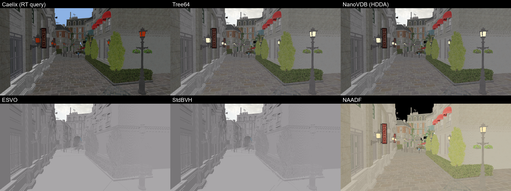

*Figure 1a. Bistro 8K, pose p1, mode P, as rendered by each harness (VoxelRT and NAADF images are flipped back to the Caelix orientation). Colours differ because the formats differ; geometry and framing match.*

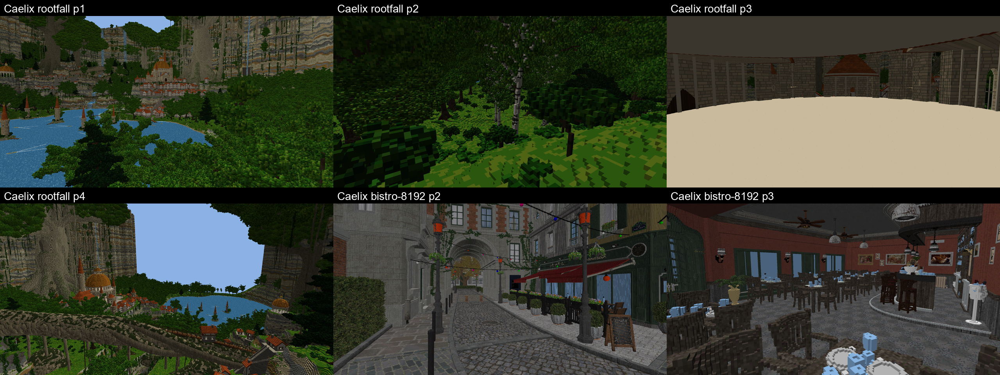

*Figure 1b. More scenes for the static benchmarks. Rootfall p3 is inside a building.*

### 4.1 Headline table (geometric mean over the poses of each scene)

Mode P, primary rays only:

| Method | bistro-8192 ms / Mrays/s | bistro-4096 ms / Mrays/s | rootfall ms / Mrays/s | iters per ray (8K) | Structure, bistro-8192 |
| --- | --- | --- | --- | --- | --- |
| **NAADF** | **0.52 / 7,086** | **0.41 / 8,965** | 0.87 / 4,223 | 16.6 | 4,642 MiB allocated, 2,406 used |
| **Caelix** | 0.93 / 3,971 | 0.71 / 5,223 | 1.07 / 3,456 | n/a (RT cores) | 5,358 MiB |
| **Tree64** | 0.89 / 4,124 | 0.72 / 5,116 | **0.92 / 4,019** | 30.2 | 502 MiB |
| XBrickMap | window | 0.60 / 6,134 | window | 23.1 (4K) | 552 MiB (4K) |
| MultiDDA | window | 0.61 / 6,005 | window | 55.7 (4K) | 2,052 MiB dense (4K) |
| ManhattanDF | window | 0.78 / 4,755 | window | 42.0 (4K) | 2,304 MiB dense (4K) |
| StdBVH | 1.63 / 2,256 | 1.21 / 3,049 | 1.90 / 1,943 | 45.6 | 385 MiB |
| NanoVDB | 2.08 / 1,771 | 1.60 / 2,310 | 2.10 / 1,758 | 88.9 | 1,012 MiB |
| ESVO | 2.13 / 1,731 | 1.68 / 2,191 | 2.24 / 1,649 | 70.5 | 370 MiB |
| PlainDDA | window | 5.89 / 626 | window | 447 (4K) | 2,052 MiB dense (4K) |

Mode B2, primary plus two diffuse bounces (rays per pixel actually cast: Caelix 2.42, every other method 2.88; see 4.3):

| Method | bistro-8192 ms / Mrays/s | bistro-4096 ms / Mrays/s | rootfall ms / Mrays/s | B2 / P time ratio (8K) |
| --- | --- | --- | --- | --- |
| **NAADF** | **5.06 / 2,124** | **3.52 / 3,055** | 5.16 / 2,017 | 9.7 |
| **Tree64** | 5.50 / 1,930 | 4.58 / 2,318 | **5.13 / 2,023** | 6.2 |
| **Caelix** | 6.20 / 1,441 | 5.47 / 1,634 | 6.51 / 1,342 | 6.7 |
| MultiDDA | window | 8.63 / 1,229 | window | 14.1 (4K) |
| ESVO | 12.91 / 822 | 11.73 / 905 | 12.89 / 804 | 6.1 |
| StdBVH | 14.93 / 712 | 12.50 / 850 | 14.07 / 739 | 9.2 |
| NanoVDB | 17.53 / 605 | 12.60 / 842 | 13.81 / 751 | 8.4 |
| XBrickMap | window | 18.23 / 582 | window | 30.4 (4K) |
| EuclideanDF | window | 25.55 / 415 | window | 28.7 (4K) |
| ManhattanDF | window | 26.52 / 400 | window | 34.0 (4K) |
| OctantDF | window | 26.76 / 396 | window | 31.9 (4K) |
| PlainDDA | window | 45.19 / 235 | window | 7.7 (4K) |

"window" = the method's dense address window (4096 x 1024 x 4096 or 4096 x 2048 x 4096 voxels) cannot hold the scene. For the five methods limited to y < 1024, bistro-4096 is the cropped file with the 0.09 % of voxels above y = 1023 removed.

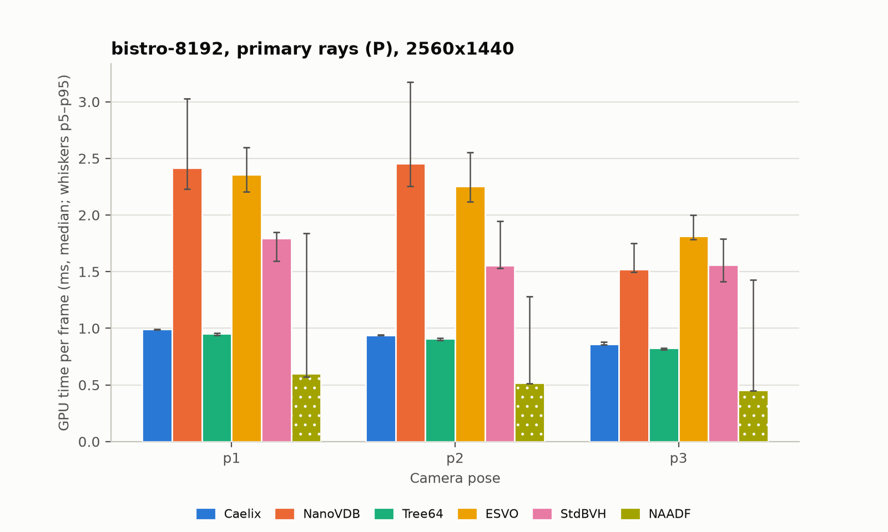

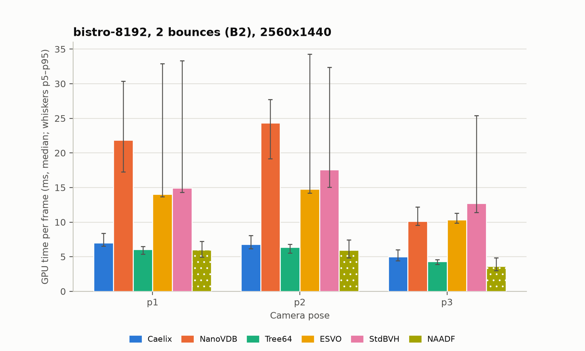

*Figures 2 and 3. Bistro 8K per pose. Whiskers are the 5th to 95th percentile of the 200 frames.*

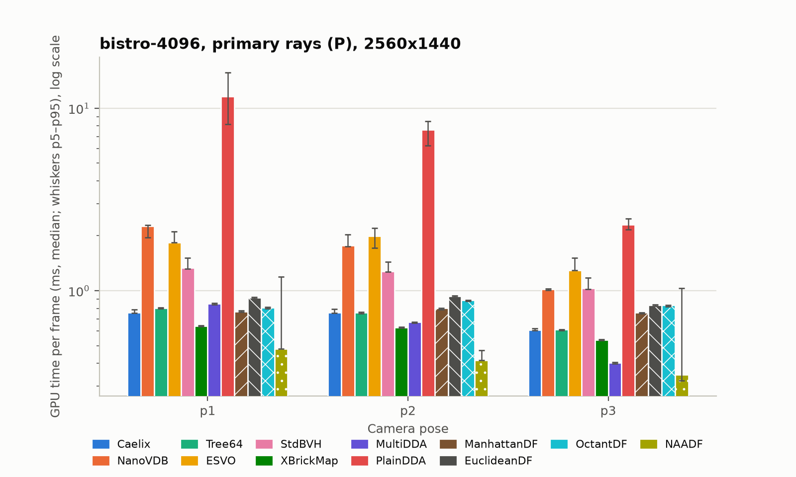

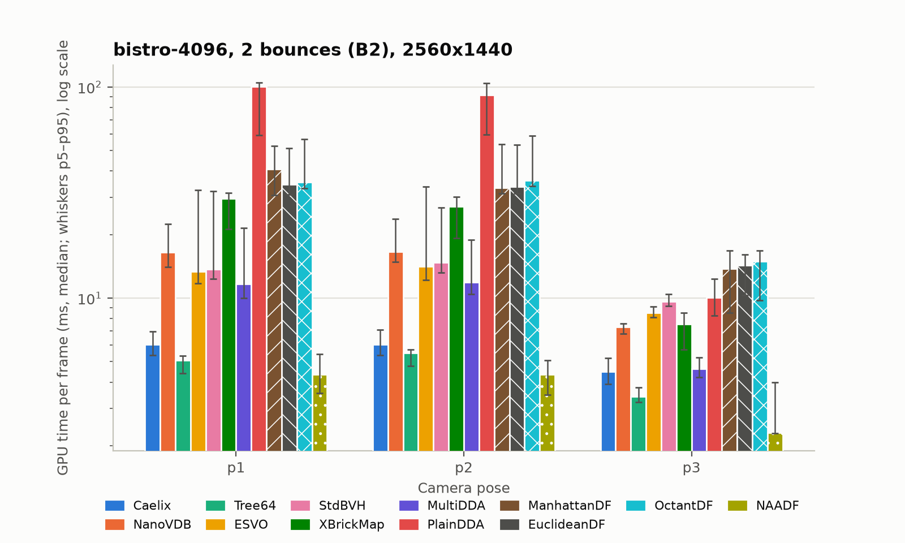

*Figures 4 and 5. Bistro 4K, the only static scene every method can hold. Note the log scale in Figure 5.*

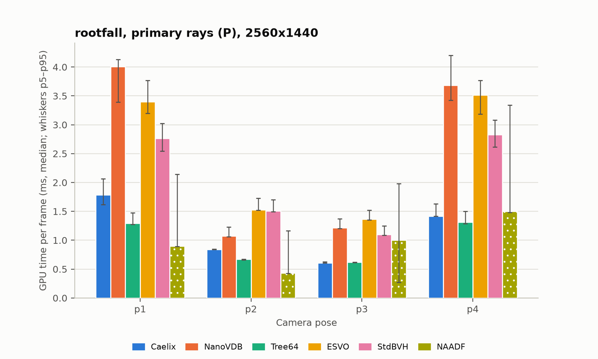

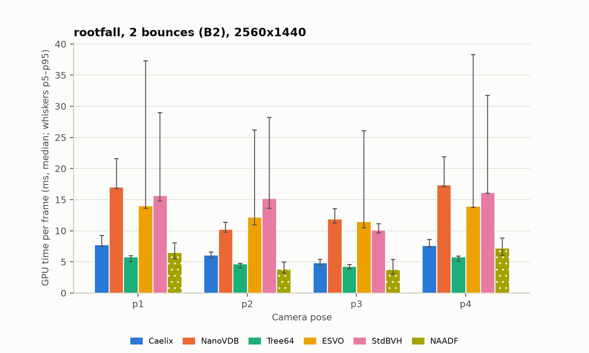

*Figures 6 and 7. rootfall (1.39 billion voxels), four poses.*

### 4.2 Primary rays: three methods within 2x of each other, NAADF ahead

- **NAADF is the fastest primary-ray tracer on every scene**: 0.52 ms on the 8K Bistro (7,100 Mrays/s), 1.7 to 1.8x faster than Caelix and Tree64. Its iteration count is the lowest (13 to 17 per ray): a ray crosses whole empty boxes, and the structure has only three levels. This agrees with the authors' paper (7,029 Mrays/s at 2160p on an RTX 3090 Ti for San Miguel).
- **Caelix and Tree64 are equal within 5 %** on both Bistro scenes (0.93 vs 0.89 ms at 8K). The RT cores plus the in-brick DDA cost the same as a well-written 64-tree in a compute shader. On rootfall, a very dense scene with long views (p1 and p4 look across the whole landscape), Tree64 is 14 % faster than Caelix (0.92 vs 1.07 ms); Caelix's worst pose (p1, 1.79 ms) is the one with the most AABB candidates per ray, which is the known cost of leaving the RT cores for every brick hit.
- **XBrickMap and MultiDDA are slightly faster than Tree64 at 4K** (0.60 ms) because a direct grid lookup has no tree descent; they pay for it with a fixed 2 GiB dense grid and a 4096-voxel window.
- **NanoVDB and ESVO are the slowest tree methods for primary rays** (about 2.1 ms at 8K, 70 to 90 iterations per ray). For NanoVDB this is structural: the hierarchical DDA skips empty 8, 128 and 4096-voxel nodes but steps single voxels inside every leaf that exists, and the voxelized Bistro has thin, surface-like leaves, so most of the 89 iterations are single-voxel steps. ESVO pays for 13 levels of 2^3 descent against 7 levels of 4^3 for Tree64.
- **StdBVH** (software BVH over bricks, 1.63 ms) is the closest software analogue of Caelix's design; Caelix is 1.75x faster than it at 8K, which is a fair measure of what the RT cores buy over the same hierarchy traversed in software (with the caveat that the two BVHs are built differently).

### 4.3 Bounce rays: ray counts first, then time

The harnesses do not cast the same number of bounce rays:

| Harness | Rays per pixel in B2 (bistro-8192 p1) | Why |
| --- | --- | --- |
| Caelix | 2.40 (3.69 M primary + 3.52 M bounce 1 + 1.63 M bounce 2) | Russian roulette before bounce 2 with p = max albedo of the bounce-1 hit |
| VoxelRT (all methods) | 2.78 (3.69 M + 3.52 M + 3.06 M) | no Russian roulette; a bounce ray only when the previous ray hit |
| NAADF | 2.79 (3.69 M + 3.52 M + 3.09 M) | no Russian roulette; uniform hemisphere sampling |

The primary hit counts agree to the voxel (3,517,52x bounce-1 rays in all three), which confirms the poses and the scene conversions are identical. Caelix's lower count is a renderer policy, not a structure property, so **Mrays/s is the right comparison for B2**, and frame time flatters Caelix by about 15 %.

By Mrays/s on the 8K Bistro: NAADF 2,124, Tree64 1,930, Caelix 1,441, ESVO 822, StdBVH 712, NanoVDB 605. Caelix traces bounce rays 25 % slower than Tree64 and 32 % slower than NAADF per ray; it is still 1.75 to 2.4x faster than the other software structures.

The ratio of B2 time to P time (Figure 8) shows how much each structure suffers from incoherent rays. The B2 frame casts 2.4 to 2.9x the rays of P, so a ratio near 3 would mean "bounce rays cost the same as primary rays". Nobody is near 3:

| Method | B2 / P (8K Bistro) | B2 / P (4K Bistro) | Reading |
| --- | --- | --- | --- |
| ESVO | 6.1 | 6.9 | stack traversal degrades least |
| Tree64 | 6.2 | 6.3 | |
| Caelix | 6.7 | 7.7 | RT cores help coherent rays more than incoherent ones |
| NanoVDB | 8.4 | 7.9 | |
| StdBVH | 9.2 | 10.3 | |
| NAADF | 9.7 | 8.5 | fastest in absolute terms, but loses the most relative to its primary rays |
| MultiDDA | | 14.1 | |
| XBrickMap, distance fields | | 29 to 34 | the parametric marchers collapse on incoherent rays |

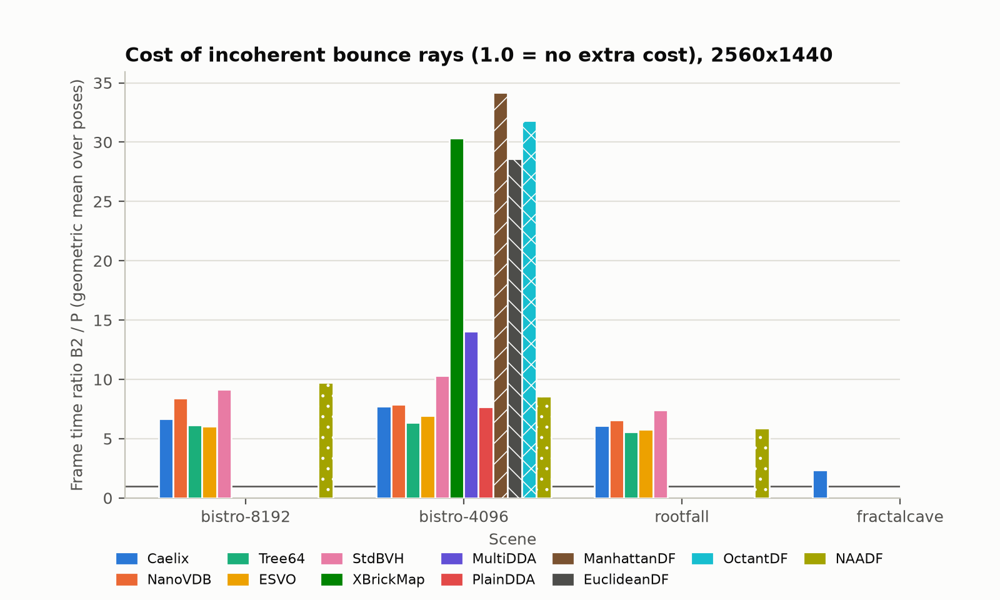

*Figure 8. Frame-time ratio B2 / P per method and scene (geometric mean over poses). Lower is better; about 2.4 to 2.9 would be "no penalty for incoherence".*

A control experiment (`results/experiments/coarse/`) re-ran the VoxelRT B2 cases with the backends' original "coarse" bounce shortcuts enabled (XBrickMap reports a hit at the first occupied 4^3 cell after 20 iterations, Tree64 stops at the first leaf): XBrickMap drops from 29.7 to 24.2 ms, Tree64 from 5.1 to 4.5 ms, the distance fields change by less than 10 %. So the shortcuts explain at most a fifth of the gap; the rest is the traversal itself. Why XBrickMap's bounce rays cost 30 ms with only 25 iterations per ray (Tree64 needs 24 iterations and 5 ms) was not resolved in this study; the upstream README measured XBrickMap close to Tree64 on an integrated GPU, so this may be an RTX-specific divergence effect of its parametric loop.

### 4.4 Memory

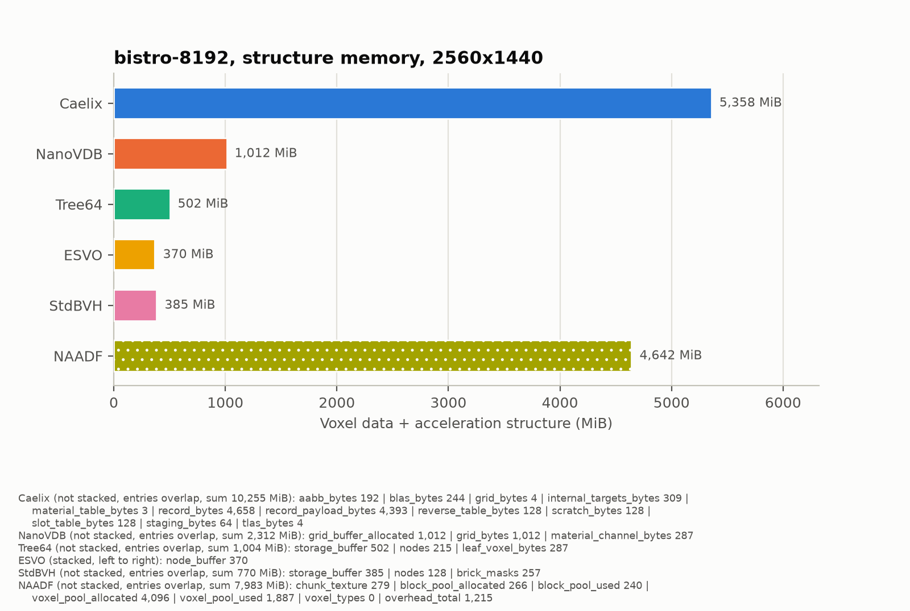

*Figure 9. Voxel data plus acceleration structure for the 8K Bistro (301 M voxels, 4.2 M bricks).*

| Method | bistro-8192 (301 M voxels) | rootfall (1,394 M voxels) | Bytes per non-empty voxel (8K) | What is stored |
| --- | --- | --- | --- | --- |
| ESVO | 370 MiB | 661 MiB | 1.29 | topology only, no materials |
| StdBVH | 385 MiB | 622 MiB | 1.34 | 16 B nodes + 64 B occupancy per brick, no materials |
| Tree64 | 502 MiB | 1,809 MiB | 1.75 | 12 B nodes + 1 B per leaf voxel (materials) |
| NanoVDB (OnIndex + uint8 channel) | 1,012 MiB | 2,309 MiB | 3.52 | 96 B per leaf + 1 B per active voxel + 0.46 GiB of 16^3 nodes |
| NAADF | 2,406 MiB used (4,642 allocated) | 4,179 used (4,821 allocated) | 8.4 used | dense chunk grid (279 MiB at 8K), hashed 4^3 blocks, 2 B per voxel incl. empty voxels of mixed blocks |
| Caelix | 5,358 MiB | 8,264 MiB | 18.6 | 1,096 B per brick record (512 x 2 B raw values + mask) + 16 B id slots + AABB/BLAS/TLAS; records are allocated in 274 MiB pages |

Caelix uses 10.7x the memory of Tree64 for the same Bistro and 4.6x on rootfall. The reason is not the acceleration structure: BLAS + TLAS + AABBs are 440 MiB at 8K (8 % of the total, about 110 B per brick including the AABB list, in line with the published 53 B per AABB on OptiX). It is the lossless record: 2 bytes per voxel for every voxel of every non-empty brick, empty voxels included, while Tree64 stores 1 byte per present voxel and the trees store nothing for empty voxels. The voxelized Bistro has 72 voxels per brick on average (14 % full), so 86 % of Caelix's record bytes describe air. rootfall is denser (205 voxels per brick), which is why the ratio shrinks to 4.6x there. NAADF has the same "store the empty voxels of a mixed block" property at 4^3 granularity, plus a dense chunk grid, which puts it second.

Process VRAM after loading the 8K Bistro (device-local heap in use, including G-buffers and pools): Caelix 5.64 GiB, NAADF 5.37 GiB (9.67 GiB peak during generation), NanoVDB 1.26 GiB, Tree64 0.76 GiB, ESVO 0.67 GiB, StdBVH 0.69 GiB.

### 4.5 Load and construction time (file to traceable)

| Method | bistro-8192 | rootfall | Notes |
| --- | --- | --- | --- |
| Caelix | 2.5 s | 5.4 s | streaming upload of records, GPU finalize, BLAS/TLAS builds |
| NanoVDB | 4.8 s | 9.3 s | 1.2 s CPU grid build at 8K (parallel leaves, serial insert) + upload |
| Tree64 | 7.0 s | 12.3 s | single-threaded CPU tree build |
| ESVO | 6.8 s | 11.4 s | single-threaded CPU build |
| StdBVH | 6.2 s | 10.6 s | single-threaded high-quality BVH build |
| NAADF | 10.8 s | 16.6 s | zip read 6 s + GPU generation 4.6 s + distance-field convergence (168 frames, 0.2 s) |

All are seconds, none is "painfully slow". Caelix is the fastest to a traceable state because its structure is built on the GPU in parallel.

## 5. The dynamic scene (FractalCave)

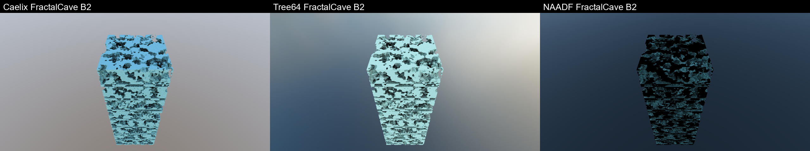

*Figure 10. FractalCave in mode B2 from the benchmark pose (Caelix, Tree64, NAADF). The 384 x 1024 x 384 block fills about 16 % of the pixels.*

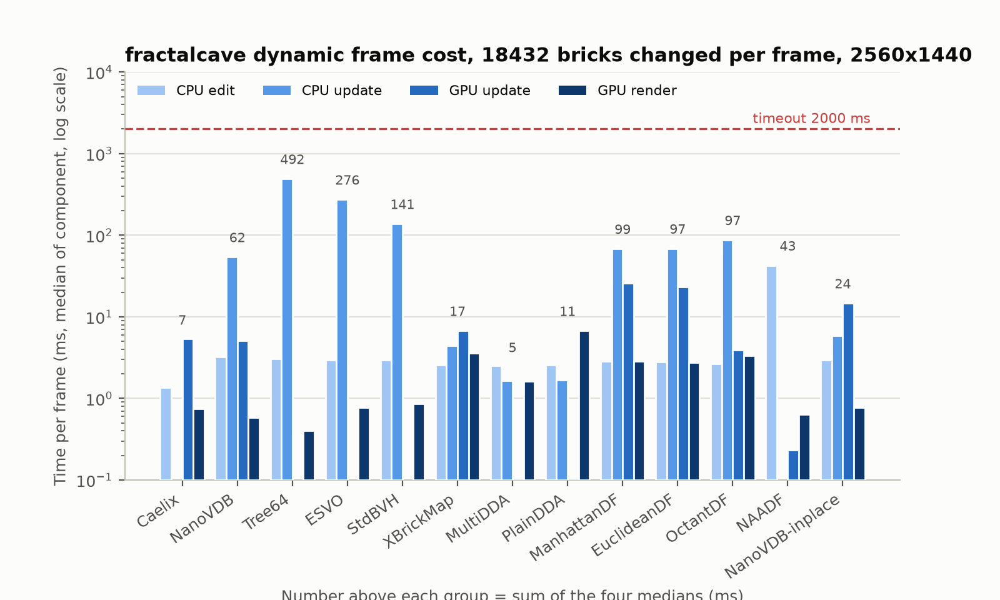

*Figure 11. Per-frame cost of toggling 18,432 bricks (4.7 M voxels) and rendering, log scale. CPU edit = writing the toggles into the harness's CPU copy; CPU update = structure rebuild or sync work on the CPU; GPU update = upload, finalize, rebuild kernels; GPU render = mode B2 trace.*

| Method | CPU edit | CPU update | GPU update | GPU render | Total per frame | Update path |
| --- | --- | --- | --- | --- | --- | --- |
| **Caelix** | 1.3 ms | — | 5.2 ms | 0.65 ms | **7 ms** | re-upload 18,432 records (19.3 MiB), finalize kernel, rebuild 72 BLAS + TLAS |
| MultiDDA | 2.4 | 1.5 | 0.01 | 1.5 | 5 ms | per-brick bit update, no materials |
| PlainDDA | 2.5 | 1.6 | 0.01 | 6.7 | 11 ms | same, but slow rendering |
| XBrickMap | 2.5 | 4.3 | 6.7 | 3.5 | 17 ms | re-upload the touched 32^3 sectors (whole sectors, GPU copy) |
| NanoVDB-inplace (not official) | 2.9 | 5.8 | 14.6 | 0.67 | 24 ms | copy 18,432 edited 608 B leaves into a grid with a leaf for every brick position |
| **NAADF** | 42.4 | — | 0.13 | 0.54 | **43 ms** | CPU re-hash of 4,608 touched 16^3 chunks under a global lock; GPU re-queues distance fields (converge 19 frames later) |
| NanoVDB (rebuild) | 3.2 | 53.8 | 5.0 | 0.48 | 62 ms | full CPU grid rebuild + upload |
| ManhattanDF / EuclideanDF | 2.7 | 68 | 24 | 2.7 | 97 to 99 ms | tile rebuild of the distance field |
| OctantDF | 2.6 | 87 | 3.9 | 3.3 | 97 ms | full rebuild |
| StdBVH | 2.9 | 137 | — | 0.76 | 141 ms | full CPU BVH rebuild |
| ESVO | 2.8 | 273 | — | 0.67 | 276 ms | full CPU octree rebuild |
| Tree64 | 2.9 | 489 | — | 0.30 | 492 ms | full CPU tree rebuild |

Nobody hit the 2 s timeout, so no method is "cannot run"; but only the first five rows are interactive at 60 Hz with this edit rate, and only Caelix and XBrickMap among them keep materials. Caelix's 5.2 ms GPU update for 18,432 bricks per frame is the cost of its design choice (GPU-side records plus per-group BLAS rebuilds) paying off: the CPU does nothing but copy 19 MiB. NAADF's edit path is CPU-bound, as its authors state, and its distance fields are stale for about 19 frames after each edit (correctness is kept, only skipping efficiency drops). The three tree builders are 20 to 70x slower than Caelix per frame; path copying (not implemented in VoxelRT) would bring Tree64 and ESVO to a few milliseconds, as the owner expected, but that is work the reference implementations do not contain. NanoVDB's in-place variant shows what the format allows when topology never changes: a 24 ms frame, dominated by the 18,432 leaf copies and the loss of 8-voxel skipping inside pre-allocated empty leaves (its render time rises from 0.48 to 0.67 ms).

Render times in this scene are small because the block covers 16 % of the pixels; the ray count per pixel is 1.21 for all methods except NAADF, which counts only the rays that enter the world box (0.36 per pixel), so NAADF's Mrays/s on this scene is not comparable.

For context: Unity's own FractalCave run with the Caelix native plugin measured a 3.9 to 4.7 ms flush per frame for the same 18,432 bricks (validation note of 2026-10-18); the host-only number here (5.2 ms) includes the 72 BLAS rebuilds and is consistent with it.

## 6. NanoVDB: answer to the owner's question

NanoVDB could be benchmarked meaningfully: the official headers build a grid from the same bricks on the CPU, and NVIDIA's portable `PNanoVDB.h` traces it in the same Vulkan harness and shader language as the other software methods (Slang compiled it without changes). Image parity with Tree64 is 99.65 % of pixels identical; the rest are entry-face ties on voxel edges.

What the numbers say:

- For opaque, surface-like voxel scenes NanoVDB's HDDA is 2.3x slower than Tree64 on primary rays and 3.2x slower on bounce rays, and uses 2x the memory of Tree64 (1.0 GiB vs 0.5 GiB for the 8K Bistro) in its most compact value-bearing layout. Its design targets volumes and narrow-band level sets, where leaves are dense; on a 14 %-full surface voxelization it spends most of its 89 iterations per ray stepping single voxels inside leaves. The 16^3 and 32^3 internal nodes are 34 KB and 270 KB each, which puts a 0.46 GiB floor under the 8K scene before any leaf.
- It beats ESVO on bounce rays only at 4K and is roughly tied with it elsewhere; it is behind StdBVH on primary rays and ahead of it on bounce rays at 4K.
- Editing: in-place value edits are possible but topology changes need a full rebuild (62 ms here, CPU); the GPU builders exist only in CUDA.
- The NVIDIA recommendation makes sense for volumetric data, for interoperability with OpenVDB tools, or as a pre-built sparse index that an RTX pipeline consumes; as the primary acceleration structure for a voxel game engine it is beaten by the 64-tree and by NAADF on every axis measured here, and by Caelix on speed and update cost (not memory).

## 7. What this means for Caelix

1. **Traversal speed is competitive, not dominant.** Caelix's hardware ray query traces primary rays as fast as the best software 64-tree and 1.8x slower than NAADF; bounce rays 25 % slower than Tree64 and 32 % slower than NAADF per ray. The RT cores pay for the TLAS/BLAS walk, but every brick hit leaves the fixed-function unit for a 22-step DDA in the shader; on long, grazing views (rootfall p1/p4) this shows as 1.4 to 1.8 ms primary frames where Tree64 needs 1.3.
2. **Memory is the weak point.** 18.6 bytes per voxel against 1.3 to 3.5 for the trees. The lossless 1,096-byte record per brick stores air; a 512-bit mask plus packed present voxels (as Tree64 does) would cut the 8K Bistro from 5.4 GiB to roughly 0.9 GiB (mask + 2 B per present voxel + AABB/BLAS) at the cost of a variable-size record. The AABB/BLAS part is only 8 % of the memory, so the hardware RT choice is not the memory problem.
3. **Updates are the strong point.** 7 ms per frame for 18,432 changed bricks, all on the GPU, with materials, against 43 ms for NAADF (CPU hashing) and hundreds of milliseconds for the trees as implemented. This is the owner's design goal (GPU-only records, per-group BLAS) and it holds up.
4. **The B2 / P ratio (6.7) is in the middle of the field.** The incoherence penalty of the ray query is similar to the trees; the RT cores do not make bounce rays cheap, they make them no worse.
5. If primary-ray speed matters more than memory, the NAADF approach (3 fixed levels, directional empty-space boxes) is the fastest traversal measured on this GPU, by 1.7x, and its idea is compatible with bricks: an axis-aligned distance in the brick slot row would let Caelix skip empty groups without an acceleration structure query.

## 8. Limitations and threats to validity

- **Different APIs and shader compilers.** VoxelRT and Caelix run on Vulkan; NAADF on D3D11 (fxc, shader model 5). NAADF's timings come from D3D11 timestamp queries bracketing its compute passes; the other two use Vulkan timestamp queries around the trace dispatch. The 1.7x NAADF lead on primary rays is larger than any plausible API effect, but a D3D12/Vulkan port of NAADF would be a cleaner comparison.
- **Harness changes.** All VoxelRT backends run with maximal Slang optimization and three bug fixes (StdBVH out-of-bounds read, ESVO pointer arithmetic, Tree64 outside-camera clipping) that upstream does not have; upstream's README numbers (integrated GPU, unoptimized shaders) are not comparable. Bounce rays in VoxelRT use exact traversal; the control run with the original shortcuts is reported in 4.3.
- **Ray generation and shading.** Caelix applies Russian roulette and casts 15 % fewer bounce rays; NAADF samples the hemisphere uniformly, so its bounce rays are more often grazing. Mrays/s normalizes the count but not the direction distribution. The primary hit counts match exactly across harnesses, so the views are identical.
- **Materials.** VoxelRT uses a 240-entry palette (quantized colours, white emission, glass as opaque); NAADF turns glass into mirrors (183 mirror segments per frame at 8K p1, negligible); Caelix keeps the original materials. Bounce ray counts agree within 0.3 %, so this does not affect the traversal numbers.
- **Slow stretches in ESVO and StdBVH B2 runs.** Their B2 frames contain contiguous stretches of 1.5 to 3.7x slower frames (about frames 110 to 130 of the 200 measured in every run, p95 about twice the median at 8K); Tree64, NanoVDB and Caelix do not show them in the same session. A repeat of the ESVO 8K p1 B2 case with a GPU clock log (`results/experiments/clock/`) reproduced the stretch at the same frame indices, with the SM clock at 2.87 GHz and no throttle reason reported by the driver, so it is not thermal or power throttling; the cause (both renderers keep their structure in host-visible memory, which is the one thing they share and Tree64 does not) was not resolved. The medians are robust to it; the repeat's median was 16.4 ms against 14.1 ms in the main run, so take ESVO and StdBVH B2 numbers as about 15 % uncertain. The GPU was shared with no other process during the measured runs (a lock serializes every harness), and vsync was off.
- **Scene coverage.** Three static scenes (two of them the same model at two resolutions) and one synthetic dynamic scene; all are Y-up voxelizations of surfaces or terrain. Volumetric or very sparse scenes (where NanoVDB and the distance fields might do better) were not tested.
- **Memory accounting.** "Structure" is what each harness reports from its own allocations; Caelix counts whole 274 MiB record pages, NAADF reports allocated and used pool sizes (its pools are sized for a 4 GiB cap), XBrickMap allocates 2 GiB regardless of use. The table in 4.4 states which number is used.
- **CPU times** (loads, CPU rebuilds) were measured while other processes (scene converters) sometimes ran; they are indicative, not precise.
- **Single machine, single driver.** RTX 5080, driver 610.88. Ratios between methods should transfer to other RTX GPUs; absolute numbers will not.

## 9. Reproduction

Everything is in `F:\RP_Games\Caelix-family\Artifacts\caelix-benchmarks\`:

- `README.md` (this folder's index), `report.md` (this report), `notes/` (the research notes per harness and the literature review with sources), `scenes/` (converted scenes + `README.md` with the conversion table and coordinate offsets), `scripts/` (converters, `run_caelix.py`, `run_voxelrt.py`, `run_naadf.py`, `aggregate.py`, `gpu_lock.py`), `results/<harness>/*.json` (one file per run, schema in `notes/results-schema.md`), `results/reference-views/`, `results/experiments/`, `tables/`, `figures/`.
- Code branches: `bench/caelix-benchmarks-20261018` in `Caelix-Renderer`, `D:\RP_CG\VoxelRT` and `Research/NAADF`.
- Order of a full rerun: build the three harnesses (see `notes/*.md`), convert the scenes (`scenes/README.md`), then `python scripts/run_caelix.py`, `python scripts/run_voxelrt.py`, `python scripts/run_naadf.py` (each takes the GPU lock), then `uv run --with numpy --with matplotlib python scripts/aggregate.py`.

## 10. Sources

The background claims in Section 2 are documented with DOIs and URLs in `notes/literature.md` (Laine and Karras 2010 for ESVO; dubiousconst282 2024 and the VoxelRT README for 64-trees; Ulschmid et al., Eurographics 2026, for NAADF; Museth 2013/2014/2021 for VDB, HDDA and NanoVDB; Lacewell 2021, Soderlund et al. 2022 and Derin et al. 2021 for hardware ray tracing of voxels). NanoVDB headers: OpenVDB v13.1.0, Apache-2.0 (`third_party/nanovdb/`).
